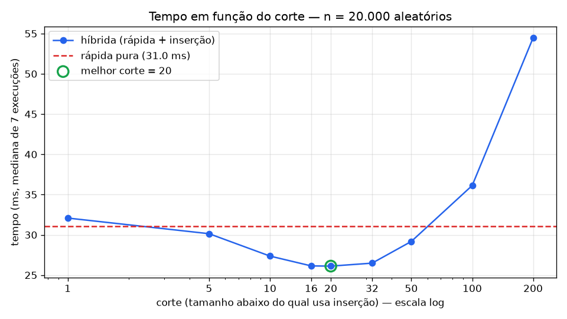

# Ordenação híbrida: rápida + inserção

Na Aula 11 vimos que a **inserção** é a melhor escolha para *n* pequeno, e na Aula 12 que a **rápida** com pivô aleatório chega a *n log n* e que "nenhuma biblioteca usa um método puro". Aqui juntamos as duas e medimos onde fica o ponto de troca.

Código: [hibrida.py](hibrida.py) (rodar com `python hibrida.py`).

## Implementação

- `rapida(v)`: rápida pura. Pivô sorteado com `random.choice`, a lista é separada em **menores, iguais e maiores** e só menores e maiores voltam para a recursão. A parte dos iguais já está no lugar definitivo, o que evita o pior caso com valores repetidos.
- `hibrida(v, corte)`: a mesma rápida, mas quando o pedaço tem **menos que `corte` elementos** chama `insercao(v)` no lugar de continuar dividindo.
- `insercao(v)`: a inserção da Aula 11, que pega o próximo e encaixa no lugar.

## Metodologia

- 20.000 inteiros aleatórios entre 0 e 1.000.000, gerados com semente fixa (2026). Todas as versões ordenam **os mesmos dados**.
- Cada configuração rodou 7 vezes sobre uma cópia da lista. A tabela mostra a **mediana** do tempo, que é menos sensível a interrupções do sistema que a média.
- Toda saída foi conferida contra `sorted(dados)`.
- Ambiente: Python 3.14, Windows 11.

## Resultados

| corte | tempo (ms) | ganho sobre a rápida pura | comparações* |
|------:|-----------:|--------------------------:|-------------:|
| rápida pura | **31,04** | — | 1.082.409 |
| 1   | 32,08 | −3,4% (ruído) | 1.082.409 |
| 5   | 30,14 | +2,9% | 998.616 |
| 10  | 27,36 | +11,8% | 962.584 |
| 16  | 26,14 | +15,8% | 957.363 |
| **20** | **26,11** | **+15,9%** | 937.446 |
| 32  | 26,48 | +14,7% | 925.726 |
| 50  | 29,18 | +6,0% | 967.122 |
| 100 | 36,13 | −16,4% | 1.000.029 |
| 200 | 54,47 | −75,5% | 1.300.323 |

\* As comparações foram contadas numa execução separada com a semente 7, para que todas as versões sorteiem os mesmos pivôs. Cada separação conta 3 comparações por elemento, uma para cada filtro: menores, iguais e maiores.

## Melhor corte e ganho

O melhor tempo saiu com **corte = 20**: **26,11 ms** contra **31,04 ms** da rápida pura, um ganho de cerca de **16%**. O corte 16 ficou praticamente empatado (26,14 ms) e o 32 bem perto (26,48 ms). O resultado mais honesto é que existe uma **faixa ótima entre 16 e 32**, e dentro dela a diferença está no nível do ruído de medição. Essa faixa coincide com os valores usados por bibliotecas reais: o Timsort do Python trabalha com pedaços de 32 a 64, e várias implementações de quicksort usam de 10 a 20.

**Por que ganha?** Perto das folhas da recursão, a rápida gasta muito para pouco resultado. Para separar um pedaço de 8 elementos ela sorteia um pivô, cria três listas novas, faz duas chamadas recursivas e concatena as listas. Nessa escala a inserção, que é O(n²), resolve com pouquíssimas operações e sem criar lista nenhuma. É o que a Aula 11 dizia: "n pequeno, use inserção".

## O que acontece com cortes grandes demais

A partir de 50 a curva sobe rápido. Com corte 100 a híbrida já fica **16% mais lenta** que a pura, e com corte 200 fica **75% mais lenta** (54 ms).

O motivo é que a inserção é quadrática. Um pedaço de tamanho *k* custa por volta de *k²/4* comparações e movimentações. Com a lista dividida em cerca de *n/k* pedaços, o trabalho total da inserção fica perto de *n·k/4*, que **cresce linearmente com o corte**. Ao mesmo tempo, o que se economiza na rápida é só log₂ *k* níveis de recursão, um ganho que cresce devagar. Para *k* pequeno a economia vence. Para *k* grande o termo quadrático domina. A coluna de comparações mostra isso: o número cai até o corte 32 e depois volta a subir, chegando a 1,3 milhão no corte 200, mais do que a rápida pura.

Em Python o efeito aparece mais cedo, porque a separação da rápida usa *list comprehensions*, que rodam em C, enquanto o laço da inserção é Python puro. Por isso cada comparação da inserção sai mais cara, e o tempo piora já no corte 50, embora o número de comparações ainda esteja abaixo do da pura.

## Confirmação: corte = 1 se comporta como a rápida pura

Com `corte = 1` a condição `len(v) < 1` só é verdadeira para a lista vazia, e a inserção sobre uma lista vazia não faz nada. Todo pedaço com 1 ou mais elementos segue o mesmo caminho da rápida pura, então **a inserção nunca trabalha** e o algoritmo é a rápida pura.

Isso foi confirmado de duas formas:

1. **Comparações idênticas.** Com a mesma semente, a pura e a híbrida com corte 1 fizeram exatamente **1.082.409** comparações. Os pivôs são os mesmos e as separações também.
2. **Tempo equivalente.** 32,08 ms contra 31,04 ms. A diferença de cerca de 3% vem do teste extra `len(v) < corte` em cada chamada e da variação natural da medição, e não de um comportamento diferente.

## Conclusão

Trocar para a inserção nos pedaços pequenos deixa a rápida cerca de **16% mais rápida** com 20 mil elementos aleatórios, e o melhor corte fica **entre 16 e 32**. Abaixo disso o ganho é pequeno. Acima de cerca de 50 o custo quadrático da inserção domina e a híbrida fica pior que a rápida pura. É a combinação que as bibliotecas usam: rápida para pedaços grandes e inserção quando o pedaço fica pequeno.
